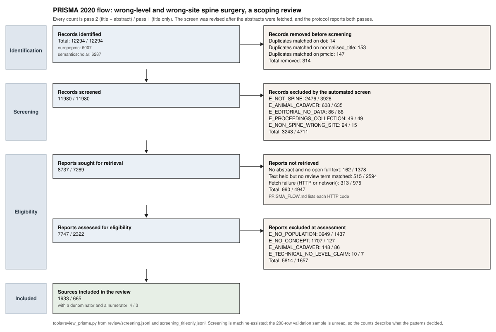

# PRISMA-ScR flow

_Wrong-level and wrong-site spine surgery: mechanisms, the imaging step that fails, and decision support - a scoping review_

Counts produced by `tools/review_prisma.py` from `review/screening.jsonl`. Every count below is a count of rows in that file carrying the named stage and reason code; no count is entered by hand.

## Identification

| source | records identified |
|---|---:|
| europepmc | 6007 |
| semanticscholar | 6287 |
| **total** | **12294** |

### Duplicates removed

| matched on | removed |
|---|---:|
| doi | 14 |
| normalised_title | 153 |
| pmcid | 147 |
| **total** | **314** |

Split by whether the duplicate came from the other source or the same one:

| matched on / scope | removed |
|---|---:|
| doi/within_source | 14 |
| normalised_title/cross_source | 33 |
| normalised_title/within_source | 120 |
| pmcid/cross_source | 147 |

## Screening

Records screened: **11980**

### Excluded at the automated screen (title and publication type)

| reason | n | what the reason means |
|---|---:|---|
| `E_NOT_SPINE` | 2476 | The record does not concern the spine at all (no spine, vertebral or spinal-region term). |
| `E_ANIMAL_CADAVER` | 608 | Animal or cadaver-only work with no clinical claim. |
| `E_EDITORIAL_NO_DATA` | 86 | Editorial, comment, letter, erratum or news item with no data. |
| `E_PROCEEDINGS_COLLECTION` | 49 | A conference proceedings container (a block of abstracts), not a chartable record. |
| `E_NON_SPINE_WRONG_SITE` | 24 | Wrong-site surgery outside the spine (wrong-site language with no spine term). |
| **total** | **3243** | |

## Full text

Full texts sought from the held corpus: **8737**

### Full texts not retrieved

| reason | n |
|---|---:|
| no full text parsed or no review term matched in it; the parse log records 3862 parsed and 2145 failed over 6007 records but does not attribute failure to a record | 258 |
| PDF retrieved but no passage matched a review term | 257 |
| no open full text | 162 |
| fetch failure: the link did not return a PDF (not_pdf(200)) | 113 |
| fetch failure: HTTP 403 | 83 |
| fetch failure: the link did not return a PDF (not_pdf(202)) | 74 |
| fetch failure: HTTP 404 | 17 |
| fetch failure: HTTP 302 | 7 |
| fetch failure: URLError | 7 |
| fetch failure: InvalidURL | 3 |
| fetch failure: RemoteDisconnected | 2 |
| fetch failure: HTTP 429 | 2 |
| fetch failure: HTTP 500 | 2 |
| fetch failure: 410 | 1 |
| fetch failure: HTTP 502 | 1 |
| fetch failure: TimeoutError | 1 |
| **total** | **990** |

## Assessment

Records assessed against the criteria: **7747**

### Excluded at assessment

| reason | n | what the reason means |
|---|---:|---|
| `E_NO_POPULATION` | 3949 | No human patient, clinical or imaging-of-enumeration population. |
| `E_NO_CONCEPT` | 1707 | Spine record with no wrong-level, level-determination, enumeration or transitional-anatomy claim. |
| `E_ANIMAL_CADAVER` | 148 | Animal or cadaver-only work with no clinical claim. |
| `E_TECHNICAL_NO_LEVEL_CLAIM` | 10 | Purely technical imaging paper with no level-determination claim. |
| **total** | **5814** | |

## Included

Records included: **1933**

Of those, records carrying both a denominator and a numerator, and so usable for a proportion synthesis: **4** (`review/incidence.csv`).

## A note on where the boxes sit

Records with no retrieved text are counted in the full-text box rather than at the automated screen, so that the flow separates 'not judged' from 'judged and excluded'.

The screen is machine-assisted. Its precision and recall are not known and cannot be stated until the `human_decision` column of `review/validation_sample.csv` is filled in.
