# Board

As of commit 6a4f64e on main. Rewritten by .github/workflows/board.yml; do not edit by hand.

## Claims (open claude/<issue> branches and docs/agents/claims/<issue>.md)

| Issue | Branch | Worker | PR | Files it touches |
| --- | --- | --- | --- | --- |
| (none) |  |  |  |  |

## Open pull requests

| PR | Title | Branch | State (clean, behind, conflicting, blocked, unknown) | Last update |
| --- | --- | --- | --- | --- |
| (none) |  |  |  |  |

## Overlaps (files that more than one piece of open work changes; land the work in this order: a blocker first, then work marked ready, then the oldest)

| File | Open work, in the order it should land |
| --- | --- |
| (none) |  |

## Queue (open issues labelled todo, unclaimed and given to no worker)

| Issue | Title | Labels |
| --- | --- | --- |
| #17 | Task: 10_data_platform_grid  build the holding index | todo |
| #18 | Task: 10_data_platform_grid  fix xray_dataset_usage.py (buu_2000 mislabel, substring keys) | todo |
| #19 | Task: 11_students_grid_access  test whether git is tolerated on the login node, and whether the grid reaches GitHub (so a Beethoven session can work spine-program itself) | todo |
| #20 | Task: 11_students_grid_access  bring the Beethoven guide headers to release 14.0.0 | todo |
| #21 | Task: 03_ctspinopelvic1k_dataset  record the answers to D3 and D4 (record 0500, the two records without PI) | todo |
| #22 | Task: 03_ctspinopelvic1k_dataset  establish the generators of fig_hardware.pdf and label_census_v11.csv | todo |
| #23 | Task: 04_openspinetoolkit  CT-1, fix the canal-closing regression | todo |
| #24 | Task: 04_openspinetoolkit  flag or fix the whole-sacrum S1 fallback on v11 | todo |
| #25 | Task: 05_ct_morphometry_parity  CT-2, the anterior pelvic plane and the spinopelvic open items (blocked by #24) | todo |
| #26 | Task: 05_ct_morphometry_parity  recompute the sacrum-adjacent tables on v11 (blocked by #23, #24) | todo |
| #27 | Task: 06_transitional_ct_census  count ids 25 and 28 per raw VerSe mask against the Loeffler table | todo |
| #28 | Task: 06_transitional_ct_census  repoint anomaly_manifest.py to the v9 bank and rebuild | todo |
| #29 | Task: 12_website_pacs_demo  keep radiographs and weights out of the site tree | todo |
| #30 | Task: 12_website_pacs_demo  update pacs/README.md to the service call and the v11 scheme (blocked by #31) | todo |
| #31 | Task: 01_carm_level_detection  S0, register the reported stack | greg-first, todo |
| #32 | Task: 01_carm_level_detection  S1, measure the latency of the reported stack (blocked by #31) | greg-first, todo |
| #33 | Task: 02_transitional_naming_truth  fix fig6_score.py and re-score the open gate | greg-first, todo |
| #34 | Task: 02_transitional_naming_truth  record the LSTV-flag learning curve from the grid | greg-first, todo |
| #35 | Task: 07_plain_film_level_id  correct the wrong-bank attribution of the recurrent head | greg-first, todo |
| #36 | Task: 07_plain_film_level_id  read and record the competitor ensemble result | greg-first, todo |
| #37 | Task: 08_render_devices  settle the physics_drr count (7,045 against 7,048) | greg-first, todo |
| #38 | Task: 08_render_devices  write the PolyPose validation report | greg-first, todo |
| #39 | Task: 09_wrong_level_clinical_qi  reconcile the scoping review's counts (665, 1,933, the abstract count) | greg-first, todo |
| #40 | Task: 09_wrong_level_clinical_qi  verify Barr 2026's value at n = 700 | greg-first, todo |
| #41 | Task: 99_archive  one prefix-key text for the handoff copies in all thirteen folders | greg-first, todo |
| #42 | Task: 99_archive  fetch the two FluoroCap reports from the grid | greg-first, todo |
| #72 | Task: Greg  before the first student session (Claude GitHub App, Setup App, invites, labels, python environment) | greg-first, todo |
| #81 | Task: withhold the other datasets' patient header values still quoted on main | todo |
| #224 | Task: bring the two CNS 2026 talks (Abstract 418 LITT, Not All Spines) into cns2026_talks/ with their scripts, figures and results | todo |
| #237 | synthetic_spine: the checker confirms wrong values whose measure, group or role it does not recognise (second review of #236) | todo |
| #248 | CNS 2026: SchwingNet detection video on a simulated fluoroscopic pan | todo |

## Given to workers (open issues a worker's label names, not yet claimed)

| Issue | Title | Worker |
| --- | --- | --- |
| #123 | E1.1: Onboard to the program: grid account, Beethoven, CITI, the folder's rules | aschehr |
| #124 | E1.2: Write the REFORMS record template and the sealed-gate template | aschehr |
| #125 | E1.3: Wire beethoven-qa's gate into the program's code | aschehr |
| #126 | E1.4: Run beethoven-research's split check on every evaluation | aschehr |
| #127 | E1.5: Write the CLAIM checklist for imaging AI into beethoven-research | aschehr |
| #128 | E1.6: Monthly status to the PI and Co-PI, and the final report's skeleton | aschehr |
| #130 | E2.1: Apply the change list to IRB-26-03-8648 and submit it | Gregory-Schwing-MD-PhD |
| #131 | E2.2: Add the PI, the Co-PI and the research assistant to the protocol (blocked by #123) | Gregory-Schwing-MD-PhD |
| #132 | E2.3: Draft the exempt application for the trainee study (Aim 2) | aschehr |
| #133 | E2.4: DMC data access: the EMR and PACS request for the cohort (blocked by #130) | Gregory-Schwing-MD-PhD |
| #135 | E2.6: Cadaver set paperwork: Body Bequest Program, DLAR session, dosimetry and OEHS | aschehr |
| #137 | E3.1: Build the data dictionary in REDCap (blocked by #130) | aschehr |
| #138 | E3.2: Write the cohort query: codes, surgical logs, inclusion and exclusion (blocked by #133) | aschehr |
| #139 | E3.3: De-identification pipeline: DICOM to NIfTI, text scrubbing, the coded key (blocked by #138) | aschehr |
| #140 | E3.4: Double-code 15 percent and report agreement (blocked by #139) | aschehr |
| #141 | E3.5: Pre-register the case-control analyses (blocked by #137) | aschehr |
| #143 | E4.1: Export COBRA's 372,000 unseen projections and look at the Varian bank | aschehr |
| #144 | E4.2: Corner labels by projecting each CT's corners at the device geometry (blocked by #143) | aschehr |
| #145 | E4.3: Train the corner-learning C-arm detector, leave one device out (blocked by #126, #144) | aschehr |
| #146 | E4.4: Learned X-ray simulation until a classifier cannot tell renders from real frames (blocked by #143) | aschehr |
| #147 | E4.5: Image and seal the cadaver set (blocked by #135) | aschehr |
| #148 | E4.6: Measure the stack's latency on one GPU | aschehr |
| #150 | E5.1: Store the Elsevier key and institutional token on the grid | Gregory-Schwing-MD-PhD |
| #151 | E5.2: Harvest the spine corpus as sbatch jobs (blocked by #150) | aschehr |
| #152 | E5.3: Build the passage index with citations and DOIs (blocked by #151) | aschehr |
| #153 | E5.4: Host the grid text model that answers with verbatim quotations (blocked by #152) | aschehr |
| #156 | E6.2: Give the model the detector and the level model as tools (blocked by #155) | aschehr |
| #158 | E6.4: Write the held-out question set on public images and its grading rubric | aschehr |
| #159 | E6.5: Grade the RAG-LLM against OpenEvidence (blocked by #157, #158) | aschehr |
| #162 | E7.1: Write the 30 tasks: 10 for development, 20 sealed with hidden checks (blocked by #124) | aschehr |
| #164 | E7.3: Run the 80 runs, with and without the checks (blocked by #125, #126, #163) | aschehr |
| #165 | E7.4: The profiler and the four economies (1b) (blocked by #162) | aschehr |
| #166 | E7.5: The protocol against its competitors (1c) | Gregory-Schwing-MD-PhD |
| #168 | E8.1: Recruit eight trainees in two waves (blocked by #132) | aschehr |
| #169 | E8.2: Accounts and seats: grid, Beethoven, Claude Team seats (blocked by #168) | aschehr |
| #170 | E8.3: Write and pre-register the matched starter tasks | aschehr |
| #171 | E8.4: Run the comfort survey before and after each wave (blocked by #168) | aschehr |
| #172 | E8.5: Run the waves and report H2 (blocked by #169, #170) | aschehr |
| #174 | E9.1: Get the AIDaS office's answer on lines A, B, C3, D and F | Gregory-Schwing-MD-PhD |
| #181 | E10.4: The AIDaS symposium poster and the final report (blocked by #128) | aschehr |
| #182 | E10.5: Submit the proposal to Anthropic's AI for Science program and the other fits | Gregory-Schwing-MD-PhD |
| #186 | V01: Screen the Bern dynamic myelography videos on the grid | aschehr |
| #187 | V02: Verify the Bournemouth cervical corner tracks and make them load | aschehr |
| #188 | V03: Download the Bournemouth/AECC lumbar fluoroscopy frames (OSF z2jby) | aschehr |
| #189 | V04: Screen the DysphagiaBank UNM swallow corpus on the grid | aschehr |
| #190 | V05: Screen the seven Neurosurgical Focus videos on the grid | aschehr |
| #191 | V06: Screen the three PMC CC BY fluoroscopy clips on the grid | aschehr |
| #192 | V07: Describe the VFSS_analysis repository held on the grid | aschehr |
| #193 | V08: Screen the three Wikimedia Commons fluoroscopy items on the grid | aschehr |
| #194 | V09: Screen the 28 YouTube spine fluoroscopy videos and map each to its request letter | aschehr |
| #195 | V10: Download DIAS (intracranial DSA sequences) to the grid | aschehr |
| #196 | V11: Download Guide3D (bi-planar phantom fluoroscopy) to the grid | aschehr |
| #197 | V12: List the XMAPortal XROMM trunk studies and download the open ones | aschehr |
| #198 | V13: Request the CAMS-Knee institutional licence | Gregory-Schwing-MD-PhD |
| #199 | V14: File the CathAction access form and download it | Gregory-Schwing-MD-PhD |
| #200 | V15: Draft a request letter for the Samuel Ralls cervical cine | aschehr |
| #201 | V16: Find out whether the AJR Rosas and Lee video is live fluoroscopy and reusable | aschehr |
| #202 | V17: Find the source and access route of the pediatric IRI abdominal angiography set | aschehr |
| #203 | V18: Verify the Stan knee fluoroscopy datasets exist | aschehr |
| #204 | V19: Find the access route of VFSS-5k (C1-C7 masks on videofluoroscopy) | aschehr |
| #205 | V20: Ask the uploader of Vimeo 1109076785 for the original and permission | aschehr |
| #206 | V21: Ask the VFSS2022 authors whether the frames can be shared under an agreement | aschehr |

## Blockers (open issues labelled blocker)

| Issue | Title | Labels |
| --- | --- | --- |
| (none) |  |  |

## Recently merged (the last 5)

| PR | Title | Branch | Merged |
| --- | --- | --- | --- |
| #262 | The U251 talk, v10: the far-side tumor against its own core as a main slide | claude/local-u251-v10 | 2026-11-01T23:06:37Z |
| #261 | The U251 talk, v9: significant results forward, no backups, a journal-style identity figure | claude/local-u251-v9 | 2026-11-01T22:17:45Z |
| #260 | The U251 talk, v8: Cell-style recurrence figures and the control-adjusted drug screen | claude/local-u251-v8 | 2026-11-01T21:30:14Z |
| #259 | CNS v22 pan: boxes on each thoracic body as it comes into view | claude/local-cns-v22b | 2026-11-01T18:48:14Z |
| #258 | CNS deck v22: the pan counts through the thoracic, the smooth naming plot, the anomalies, the website | claude/local-cns-v22 | 2026-11-01T16:53:20Z |

## Dependencies

Each open epic's tasks as GitHub's sub-issues and blocked-by relations hold them: an arrow runs from the issue that blocks to the issue it blocks, dotted once the blocker is closed; a node's shade is its state, and an epic's heading counts its closed tasks.

### Goals

```mermaid
flowchart TD
  i121["#121 AIDaS 2027: a customizable spine RAG-... (0/10)"]
  i122["#122 E1: Workflow: the folder's way of wor... (0/6)"]
  i129["#129 E2: IRB and regulatory: the protocol,... (0/6)"]
  i136["#136 E3: Clinical data mining: the DMC spi... (0/5)"]
  i142["#142 E4: C-arm training: close the detecti... (0/7)"]
  i149["#149 E5: Literature data mining: the Scopu... (0/4)"]
  i154["#154 E6: The spine RAG-LLM (Aim 3): detect... (0/6)"]
  i161["#161 E7: Aim 1: the agent doing research u... (0/5)"]
  i167["#167 E8: Recruitment and Aim 2: eight trai... (0/5)"]
  i173["#173 E9: Award administration: allowabilit... (0/3)"]
  i177["#177 E10: Proposals and dissemination: CAR... (0/6)"]
  i121 ==> i122
  i121 ==> i129
  i121 ==> i136
  i121 ==> i142
  i121 ==> i149
  i121 ==> i154
  i121 ==> i161
  i121 ==> i167
  i121 ==> i173
  i121 ==> i177
  classDef todo fill:#ffffff,stroke:#0e8a16,color:#000000
  classDef claimed fill:#fff8d6,stroke:#fbca04,color:#000000
  classDef review fill:#e3f0ff,stroke:#1d76db,color:#000000
  classDef blocked fill:#ffe7e7,stroke:#e99695,color:#000000
  classDef closed fill:#eeeeee,stroke:#999999,color:#666666
```

### Epic #122: E1: Workflow: the folder's way of working, REFORMS records and the two gates (0/6)

```mermaid
flowchart TD
  i123["#123 E1.1: Onboard to the program: grid ac..."]:::todo
  i124["#124 E1.2: Write the REFORMS record templa..."]:::todo
  i125["#125 E1.3: Wire beethoven-qa's gate into t..."]:::todo
  i126["#126 E1.4: Run beethoven-research's split..."]:::todo
  i127["#127 E1.5: Write the CLAIM checklist for i..."]:::todo
  i128["#128 E1.6: Monthly status to the PI and Co..."]:::todo
  classDef todo fill:#ffffff,stroke:#0e8a16,color:#000000
  classDef claimed fill:#fff8d6,stroke:#fbca04,color:#000000
  classDef review fill:#e3f0ff,stroke:#1d76db,color:#000000
  classDef blocked fill:#ffe7e7,stroke:#e99695,color:#000000
  classDef closed fill:#eeeeee,stroke:#999999,color:#666666
```

### Epic #129: E2: IRB and regulatory: the protocol, the trainee study, DMC access, the FDA Pre-Submission (0/6)

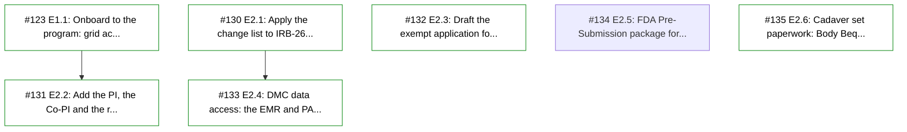

### Epic #136: E3: Clinical data mining: the DMC spine surgery cohort under the IRB (0/5)

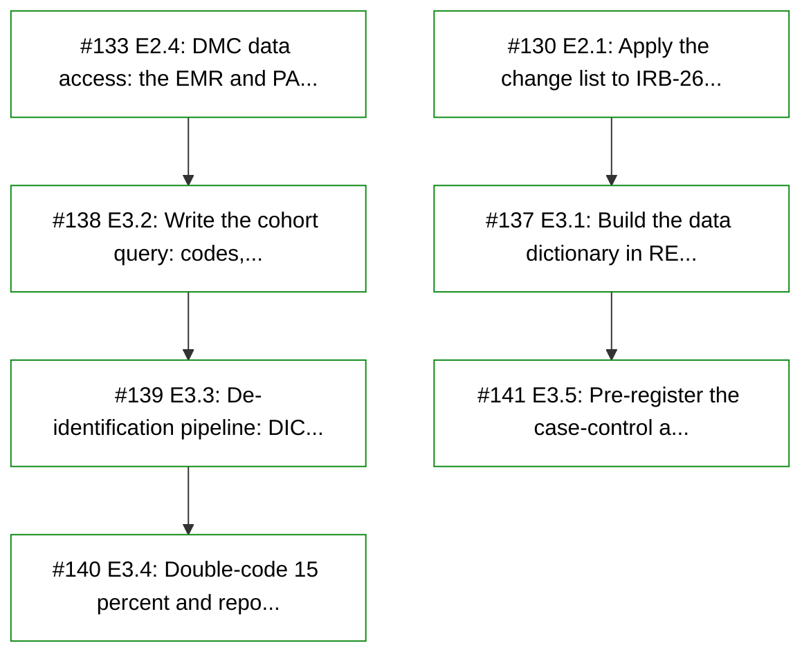

### Epic #142: E4: C-arm training: close the detection gap (Aim 3) (0/7)

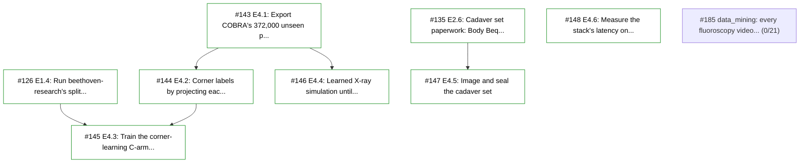

### Epic #149: E5: Literature data mining: the Scopus and ScienceDirect spine corpus on the grid (0/4)

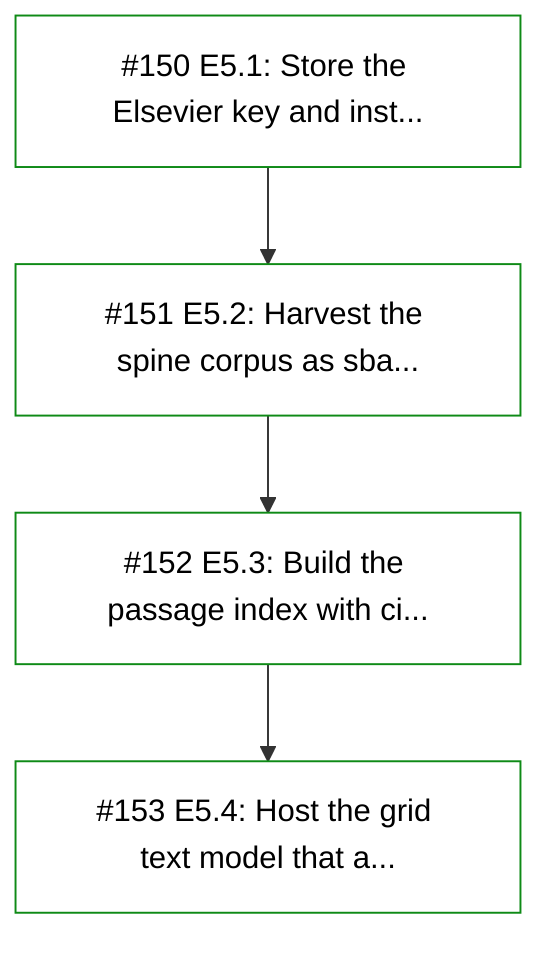

### Epic #154: E6: The spine RAG-LLM (Aim 3): detectors as tools, two releases, graded against OpenEvidence (0/6)

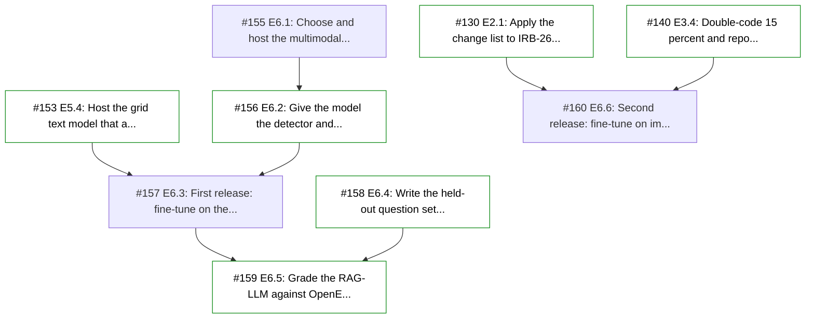

### Epic #161: E7: Aim 1: the agent doing research under the frameworks, and its cost (0/5)

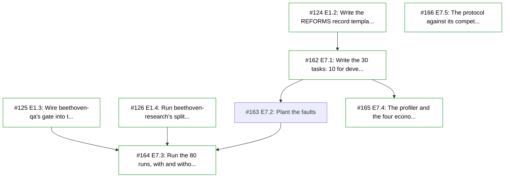

### Epic #167: E8: Recruitment and Aim 2: eight trainees drive the agent (0/5)

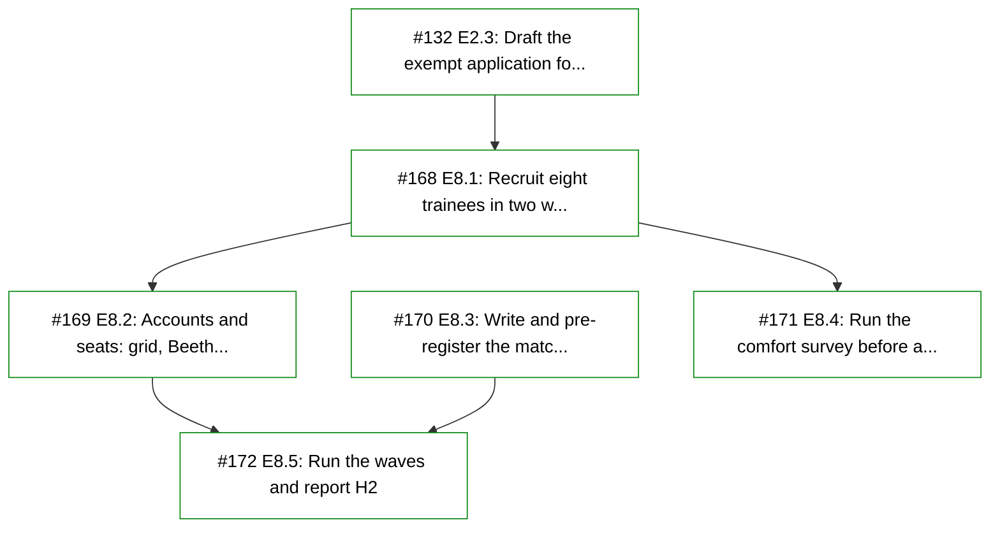

### Epic #173: E9: Award administration: allowability, hiring, purchases (0/3)

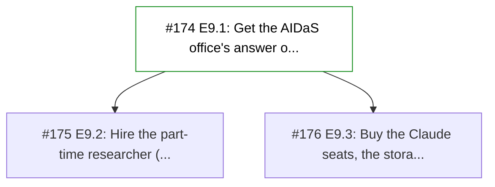

### Epic #177: E10: Proposals and dissemination: CAREER, R21, CyberTraining, the symposium (0/6)

```mermaid
flowchart TD
  i128["#128 E1.6: Monthly status to the PI and Co..."]:::todo
  i134["#134 E2.5: FDA Pre-Submission package for..."]
  i147["#147 E4.5: Image and seal the cadaver set"]:::todo
  i148["#148 E4.6: Measure the stack's latency on..."]:::todo
  i164["#164 E7.3: Run the 80 runs, with and witho..."]:::todo
  i172["#172 E8.5: Run the waves and report H2"]:::todo
  i178["#178 E10.1: NSF CAREER, due July 28, 2027"]
  i179["#179 E10.2: NIH R21 at NIBIB, due October..."]
  i180["#180 E10.3: NSF CyberTraining Pilot, due J..."]
  i181["#181 E10.4: The AIDaS symposium poster and..."]:::todo
  i182["#182 E10.5: Submit the proposal to Anthrop..."]:::todo
  i224["#224 Task: bring the two CNS 2026 talks (A..."]:::todo
  i128 --> i181
  i134 --> i179
  i147 --> i179
  i148 --> i179
  i164 --> i178
  i172 --> i180
  classDef todo fill:#ffffff,stroke:#0e8a16,color:#000000
  classDef claimed fill:#fff8d6,stroke:#fbca04,color:#000000
  classDef review fill:#e3f0ff,stroke:#1d76db,color:#000000
  classDef blocked fill:#ffe7e7,stroke:#e99695,color:#000000
  classDef closed fill:#eeeeee,stroke:#999999,color:#666666
```

### Epic #185: data_mining: every fluoroscopy video dataset, solved one by one (0/21)

### Epic #242: The student folders' open tasks: 03, 04, 05, 06, 10, 12 and synthetic_spine (0/13)

```mermaid
flowchart TD
  i17["#17 Task: 10_data_platform_grid build the..."]:::todo
  i18["#18 Task: 10_data_platform_grid fix xray_..."]:::todo
  i21["#21 Task: 03_ctspinopelvic1k_dataset reco..."]:::todo
  i22["#22 Task: 03_ctspinopelvic1k_dataset esta..."]:::todo
  i23["#23 Task: 04_openspinetoolkit CT-1, fix t..."]:::todo
  i24["#24 Task: 04_openspinetoolkit flag or fix..."]:::todo
  i25["#25 Task: 05_ct_morphometry_parity CT-2,..."]:::todo
  i26["#26 Task: 05_ct_morphometry_parity recomp..."]:::todo
  i27["#27 Task: 06_transitional_ct_census count..."]:::todo
  i28["#28 Task: 06_transitional_ct_census repoi..."]:::todo
  i29["#29 Task: 12_website_pacs_demo keep radio..."]:::todo
  i30["#30 Task: 12_website_pacs_demo update pac..."]:::todo
  i31["#31 Task: 01_carm_level_detection S0, reg..."]:::todo
  i237["#237 synthetic_spine: the checker confirms..."]:::todo
  i23 --> i26
  i24 --> i25
  i24 --> i26
  i31 --> i30
  classDef todo fill:#ffffff,stroke:#0e8a16,color:#000000
  classDef claimed fill:#fff8d6,stroke:#fbca04,color:#000000
  classDef review fill:#e3f0ff,stroke:#1d76db,color:#000000
  classDef blocked fill:#ffe7e7,stroke:#e99695,color:#000000
  classDef closed fill:#eeeeee,stroke:#999999,color:#666666
```

### Epic #243: Greg's folders' open tasks: 01, 02, 07, 08, 09 and 99 (0/12)

```mermaid
flowchart TD
  i31["#31 Task: 01_carm_level_detection S0, reg..."]:::todo
  i32["#32 Task: 01_carm_level_detection S1, mea..."]:::todo
  i33["#33 Task: 02_transitional_naming_truth fi..."]:::todo
  i34["#34 Task: 02_transitional_naming_truth re..."]:::todo
  i35["#35 Task: 07_plain_film_level_id correct..."]:::todo
  i36["#36 Task: 07_plain_film_level_id read and..."]:::todo
  i37["#37 Task: 08_render_devices settle the ph..."]:::todo
  i38["#38 Task: 08_render_devices write the Pol..."]:::todo
  i39["#39 Task: 09_wrong_level_clinical_qi reco..."]:::todo
  i40["#40 Task: 09_wrong_level_clinical_qi veri..."]:::todo
  i41["#41 Task: 99_archive one prefix-key text..."]:::todo
  i42["#42 Task: 99_archive fetch the two Fluoro..."]:::todo
  i31 --> i32
  classDef todo fill:#ffffff,stroke:#0e8a16,color:#000000
  classDef claimed fill:#fff8d6,stroke:#fbca04,color:#000000
  classDef review fill:#e3f0ff,stroke:#1d76db,color:#000000
  classDef blocked fill:#ffe7e7,stroke:#e99695,color:#000000
  classDef closed fill:#eeeeee,stroke:#999999,color:#666666
```

### Epic #244: Before the first student session: the platform steps, the accounts and what main must not quote (0/4)

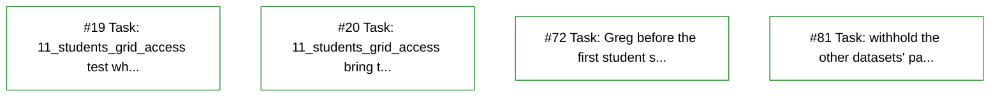
